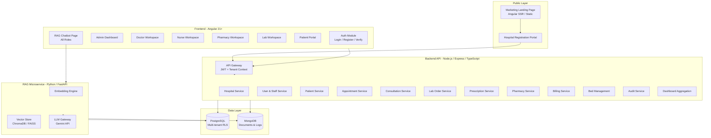
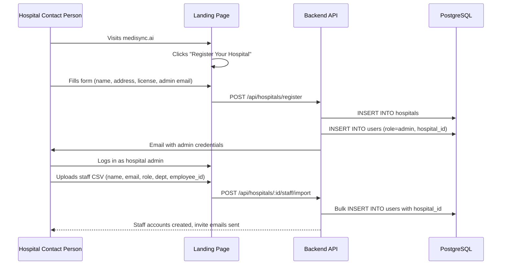
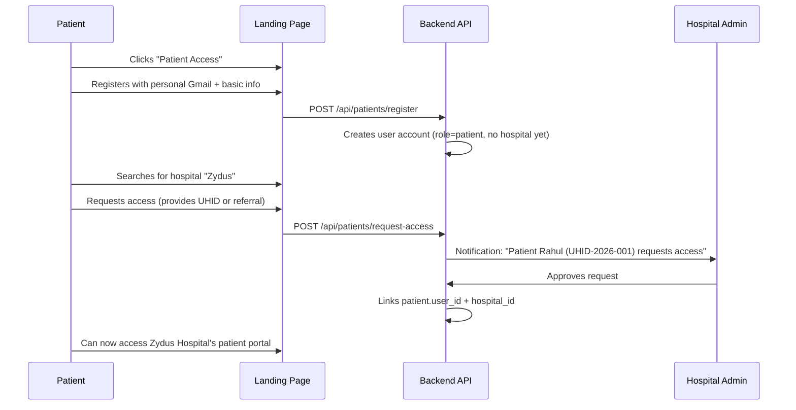
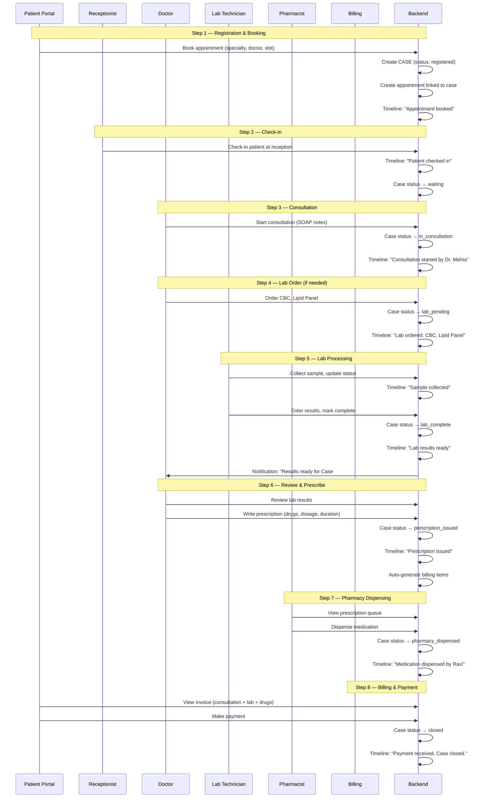

# MediSync-AI v2 — Full Rebuild Implementation Plan

## Problem Statement

The current MediSync-AI prototype is a single-tenant demo with seeded dummy data (`@medisync.local` emails), a flat folder structure, and no concept of hospital identity. The goal is to rebuild it into a **production-grade, multi-tenant Hospital EHR SaaS platform** where:

1. Hospitals register themselves and onboard their staff via CSV/Excel upload
2. Patients register independently with personal email and link to a specific hospital
3. A complete patient case lifecycle flows through Doctor → Lab → Pharmacy → Billing with full traceability
4. A RAG-powered AI chatbot runs as a separate Python microservice
5. A public marketing/landing page exists for SEO and hospital acquisition
6. The UI feels **professional and branded** — not generic AI-neon

---

## User Review Required

> [!IMPORTANT]
> **Backend Technology Choice:** I recommend keeping **Node.js (Express + TypeScript)** for the main API server because the existing codebase, middleware, and routes are already written in it. Switching to FastAPI would mean rewriting 14 route files, 2 middleware files, all DB config, and seed scripts from scratch — with no architectural benefit since the RAG chatbot will already be a separate FastAPI microservice. If you strongly prefer FastAPI for the main backend too, let me know and I'll adjust the plan.

> [!IMPORTANT]
> **Frontend Framework:** I recommend keeping **Angular** since the current codebase has ~20 components, routing, guards, interceptors, and services already built. We will restructure the folder layout and rebuild the UI design system, but rewriting in React/Next.js would add weeks with no functional gain.

> [!WARNING]
> **Multi-tenancy Model:** I'm proposing a **shared-database with `hospital_id` column** approach (Row-Level Security). This is the most practical for a SaaS product with many small-to-medium hospitals. A schema-per-tenant model would be overkill at this stage and harder to maintain. If you plan to serve very large hospital networks (500+ bed chains) that require strict physical data isolation, let me know.

## Open Questions

> [!IMPORTANT]
> 1. **Hospital Branding:** Should each hospital be able to customize their logo and color theme on their dashboard, or is a single MediSync brand sufficient for now?
> 2. **Patient Verification:** When a patient registers with their Gmail and requests access to a hospital, should the hospital admin manually approve them, or should we allow auto-approval if the patient provides a valid UHID/MRN issued by the hospital?
> 3. **Deployment Target:** Are you planning to deploy this on a cloud provider (AWS/GCP/Azure), or will it run locally/on-premise for demos? This affects the marketing site SEO setup.
> 4. **RAG Chatbot Scope:** Should the chatbot be available to ALL roles (doctor, nurse, pharmacist, lab, patient, admin) as you mentioned, or should different roles have different chatbot capabilities? (e.g., patients can only ask about their own records, doctors can query across all their patients)

---

## Proposed Architecture

### High-Level System Diagram



### Microservice Boundaries

| Service | Runtime | Responsibility |
| :--- | :--- | :--- |
| **Main API** | Node.js + Express + TS | All CRUD, auth, billing, dashboards, tenant management |
| **RAG Chatbot** | Python + FastAPI | Embedding, vector search, LLM orchestration, context retrieval |
| **Frontend** | Angular 21 | SPA with role-based routing, public marketing pages |

---

## Proposed Changes

### Folder Structure (Complete Restructure)

```
MediSync-AI/
├── frontend/                          # Angular 21 application
│   ├── src/
│   │   ├── app/
│   │   │   ├── core/                  # Singletons (guards, interceptors, services)
│   │   │   │   ├── guards/
│   │   │   │   ├── interceptors/
│   │   │   │   ├── services/
│   │   │   │   └── stores/
│   │   │   ├── features/              # Feature modules by role
│   │   │   │   ├── public/            # [NEW] Landing page, hospital registration
│   │   │   │   ├── auth/              # Login, register, verify
│   │   │   │   ├── onboarding/        # [NEW] Hospital setup wizard, CSV upload
│   │   │   │   ├── admin/
│   │   │   │   ├── doctor/
│   │   │   │   ├── nurse/
│   │   │   │   ├── patient/
│   │   │   │   ├── pharmacist/
│   │   │   │   ├── lab/
│   │   │   │   └── chatbot/           # [NEW] Shared RAG chatbot page
│   │   │   ├── shared/                # Reusable UI components
│   │   │   │   ├── components/
│   │   │   │   │   ├── layout/        # Shell, sidebar, topbar
│   │   │   │   │   ├── ui/            # Cards, tables, modals, badges, timeline
│   │   │   │   │   └── forms/         # Form controls, file upload
│   │   │   │   └── directives/
│   │   │   ├── app.routes.ts
│   │   │   └── app.config.ts
│   │   ├── assets/                    # Icons, images, fonts
│   │   ├── styles/                    # [NEW] Design system
│   │   │   ├── _variables.css         # Color tokens, spacing, typography
│   │   │   ├── _typography.css
│   │   │   ├── _components.css        # Base component styles
│   │   │   └── global.css
│   │   └── index.html
│   ├── angular.json
│   ├── package.json
│   └── tsconfig.json
│
├── backend/                           # Node.js Express API
│   ├── src/
│   │   ├── config/                    # DB connections, env loader
│   │   │   ├── postgres.ts
│   │   │   ├── mongo.ts
│   │   │   └── env.ts
│   │   ├── middleware/                # Auth, tenant context, role guard, rate limit
│   │   │   ├── auth.middleware.ts
│   │   │   ├── tenant.middleware.ts   # [NEW] Extracts hospital_id from JWT
│   │   │   ├── role.middleware.ts
│   │   │   └── validation.middleware.ts # [NEW] Request schema validation
│   │   ├── models/                    # Database models
│   │   │   ├── pg/                    # [NEW] PostgreSQL table definitions
│   │   │   │   ├── hospital.model.ts
│   │   │   │   ├── user.model.ts
│   │   │   │   ├── patient.model.ts
│   │   │   │   ├── appointment.model.ts
│   │   │   │   ├── case.model.ts      # [NEW] Patient case tracking
│   │   │   │   └── ...
│   │   │   └── mongo/                 # MongoDB schemas
│   │   │       ├── audit.schema.ts
│   │   │       ├── vitals.schema.ts
│   │   │       ├── consultation.schema.ts
│   │   │       ├── lab-result.schema.ts
│   │   │       └── chat-session.schema.ts
│   │   ├── routes/                    # Express route handlers
│   │   │   ├── auth.routes.ts
│   │   │   ├── hospital.routes.ts     # [NEW] Hospital CRUD + onboarding
│   │   │   ├── staff.routes.ts        # [NEW] CSV upload + staff management
│   │   │   ├── patient.routes.ts
│   │   │   ├── case.routes.ts         # [NEW] Case lifecycle tracking
│   │   │   ├── appointment.routes.ts
│   │   │   ├── consultation.routes.ts
│   │   │   ├── prescription.routes.ts
│   │   │   ├── lab-order.routes.ts
│   │   │   ├── pharmacy.routes.ts     # [NEW] Separate from prescriptions
│   │   │   ├── billing.routes.ts
│   │   │   ├── bed.routes.ts
│   │   │   ├── vitals.routes.ts
│   │   │   ├── dashboard.routes.ts
│   │   │   └── audit.routes.ts
│   │   ├── services/                  # [NEW] Business logic layer
│   │   │   ├── auth.service.ts
│   │   │   ├── hospital.service.ts
│   │   │   ├── case.service.ts
│   │   │   └── ...
│   │   ├── utils/                     # Helpers
│   │   │   ├── audit.ts
│   │   │   ├── id-generator.ts
│   │   │   └── csv-parser.ts          # [NEW] Staff CSV import utility
│   │   ├── data/                      # [NEW] Seed scripts, migrations
│   │   │   ├── seed.ts
│   │   │   ├── setup-db.ts
│   │   │   └── migrations/
│   │   ├── logs/                      # [NEW] Application log files
│   │   ├── app.ts
│   │   └── index.ts
│   ├── package.json
│   └── tsconfig.json
│
├── rag-service/                       # [NEW] Python FastAPI microservice
│   ├── app/
│   │   ├── main.py                    # FastAPI entrypoint
│   │   ├── config/
│   │   │   └── settings.py
│   │   ├── routes/
│   │   │   └── chat.py
│   │   ├── services/
│   │   │   ├── embedding.py
│   │   │   ├── retriever.py
│   │   │   └── llm.py
│   │   ├── models/
│   │   │   └── schemas.py
│   │   └── utils/
│   │       └── context_builder.py
│   ├── pyproject.toml
│   └── .env
│
├── docs/
├── .gitignore
└── README.md
```

---

### Multi-Tenant Database Redesign

#### [NEW] `hospitals` Table (PostgreSQL)

```sql
CREATE TABLE hospitals (
    id          UUID PRIMARY KEY DEFAULT gen_random_uuid(),
    name        VARCHAR(200) NOT NULL,           -- "Zydus Hospital"
    slug        VARCHAR(100) UNIQUE NOT NULL,     -- "zydus-hospital" (for URLs)
    domain      VARCHAR(100),                     -- "@zydus.org" (optional email domain)
    address     TEXT,
    city        VARCHAR(100),
    state       VARCHAR(100),
    phone       VARCHAR(20),
    license_no  VARCHAR(100),
    logo_url    TEXT,
    status      VARCHAR(20) DEFAULT 'active',    -- active | suspended | trial
    plan        VARCHAR(20) DEFAULT 'basic',     -- basic | professional | enterprise
    created_at  TIMESTAMP DEFAULT NOW(),
    updated_at  TIMESTAMP DEFAULT NOW()
);
```

#### [MODIFY] `users` Table — Add Hospital Context

```diff
 CREATE TABLE users (
     id              UUID PRIMARY KEY DEFAULT gen_random_uuid(),
+    hospital_id     UUID NOT NULL REFERENCES hospitals(id),
-    email           VARCHAR(100) UNIQUE NOT NULL,
+    email           VARCHAR(100) NOT NULL,
+    UNIQUE(hospital_id, email),          -- Email unique per hospital
     password_hash   VARCHAR(255) NOT NULL,
     name            VARCHAR(100) NOT NULL,
-    role            VARCHAR(20) NOT NULL,
+    role            VARCHAR(30) NOT NULL,  -- super_admin | admin | doctor | nurse | pharmacist | lab | receptionist
     specialty       VARCHAR(100),
     department_id   UUID REFERENCES departments(id),
+    employee_id     VARCHAR(50),           -- Hospital's internal staff ID
+    is_active       BOOLEAN DEFAULT true,
+    last_login      TIMESTAMP,
     created_at      TIMESTAMP DEFAULT NOW()
 );
```

#### [MODIFY] `patients` Table — Multi-Hospital Support

```diff
 CREATE TABLE patients (
     id                  UUID PRIMARY KEY DEFAULT gen_random_uuid(),
+    hospital_id         UUID NOT NULL REFERENCES hospitals(id),
+    user_id             UUID REFERENCES users(id),  -- Links to patient's login account
     uhid                VARCHAR(50) NOT NULL,
+    UNIQUE(hospital_id, uhid),
     name                VARCHAR(100) NOT NULL,
     age                 INT NOT NULL,
     gender              VARCHAR(20) NOT NULL,
     blood_group         VARCHAR(10),
     emergency_contact   VARCHAR(50),
     allergies           TEXT,
+    medical_history     TEXT,
     status              VARCHAR(20) DEFAULT 'OPD',
     created_at          TIMESTAMP DEFAULT NOW()
 );
```

#### [NEW] `cases` Table — Patient Case Lifecycle Tracker

This is the **central spine** of the EHR. Every patient visit creates a "case" that flows through the system and is visible to all roles.

```sql
CREATE TABLE cases (
    id              UUID PRIMARY KEY DEFAULT gen_random_uuid(),
    hospital_id     UUID NOT NULL REFERENCES hospitals(id),
    patient_id      UUID NOT NULL REFERENCES patients(id),
    case_number     VARCHAR(50) NOT NULL,         -- "CASE-2026-00142"
    UNIQUE(hospital_id, case_number),
    type            VARCHAR(20) NOT NULL,         -- OPD | IPD | Emergency
    status          VARCHAR(30) NOT NULL DEFAULT 'registered',
    -- Status flow: registered → in_consultation → lab_pending → lab_complete
    --              → prescription_issued → pharmacy_dispensed → billing_pending
    --              → billing_paid → closed
    assigned_doctor UUID REFERENCES users(id),
    chief_complaint TEXT,
    diagnosis       TEXT,
    admission_date  TIMESTAMP DEFAULT NOW(),
    discharge_date  TIMESTAMP,
    created_at      TIMESTAMP DEFAULT NOW(),
    updated_at      TIMESTAMP DEFAULT NOW()
);
```

#### [NEW] `case_timeline` Table — Tracks Every Event in a Case

```sql
CREATE TABLE case_timeline (
    id          UUID PRIMARY KEY DEFAULT gen_random_uuid(),
    case_id     UUID NOT NULL REFERENCES cases(id) ON DELETE CASCADE,
    event_type  VARCHAR(50) NOT NULL,
    -- e.g.: 'appointment_booked', 'consultation_started', 'lab_ordered',
    --       'lab_completed', 'prescription_created', 'drug_dispensed',
    --       'bill_generated', 'payment_received', 'discharged'
    actor_id    UUID REFERENCES users(id),
    actor_role  VARCHAR(30),
    summary     TEXT NOT NULL,
    metadata    JSONB,                            -- Flexible payload per event type
    created_at  TIMESTAMP DEFAULT NOW()
);
CREATE INDEX idx_case_timeline_case ON case_timeline(case_id);
```

All other existing tables (`appointments`, `beds`, `prescriptions`, `lab_orders`, `billing`, `departments`, `doctors`) will get a `hospital_id` column and a `case_id` foreign key where applicable.

---

### Core Workflows

#### Workflow 1: Hospital Onboarding



**CSV Format for Staff Import:**
```csv
name,email,role,department,specialty,employee_id
Dr. Priya Mehta,priya.mehta@zydus.org,doctor,Cardiology,Interventional Cardiology,EMP-001
Sister Ananya,ananya.s@zydus.org,nurse,ICU,,EMP-002
Ravi Patel,ravi.p@zydus.org,pharmacist,Pharmacy,,EMP-003
Dr. Sunita Rao,sunita.r@zydus.org,lab,Pathology,Clinical Pathology,EMP-004
```

#### Workflow 2: Patient Registration & Hospital Linking



#### Workflow 3: Complete Patient Case Lifecycle (The Core EHR Flow)

This is the **end-to-end journey** of a patient case through the hospital. Every step creates an entry in `case_timeline`, making the entire process traceable and visible to all relevant roles.



**Key principle:** At any point, any authorized user can view the case timeline to see exactly where the patient is in their journey.

---

### RAG Chatbot Microservice

#### [NEW] `rag-service/` — Python FastAPI

The chatbot is a **separate Python service** that the Node.js backend proxies requests to.

**Architecture:**
```
Frontend (Angular) → POST /api/chatbot/message
    → Node.js Backend (auth + tenant context)
        → POST http://localhost:8100/chat
            → FastAPI RAG Service
                → Retrieves patient context from PostgreSQL/MongoDB
                → Builds prompt with context
                → Calls Gemini API
                → Returns response
```

**Capabilities by Role:**
| Role | What the chatbot can access |
| :--- | :--- |
| Doctor | All patients under their care — history, vitals, labs, medications, allergies |
| Nurse | Vitals and bed status for patients in their ward |
| Pharmacist | Prescription details, drug interactions, formulary |
| Lab Tech | Lab orders, reference ranges, specimen requirements |
| Patient | Only their own records — appointments, prescriptions, lab results |
| Admin | Hospital-wide KPIs, staff activity, operational queries |

**Each role gets the same chatbot UI page** (`/chatbot`) but the backend scopes the data retrieval based on the user's role and `hospital_id`.

---

### UI Design Direction

> [!IMPORTANT]
> The UI will be redesigned with a **clean, professional healthcare aesthetic** — not neon/glassmorphism. Think of systems like Epic MyChart, Practo, or Docplanner — muted blues, clean whites, subtle shadows, readable typography.

**Design Tokens:**
- **Primary:** `#1B4D7A` (deep medical blue)
- **Secondary:** `#2E8B57` (clinical green for success states)
- **Background:** `#F5F7FA` (light grey-blue)
- **Surface:** `#FFFFFF`
- **Text Primary:** `#1A1A2E`
- **Text Secondary:** `#6B7280`
- **Danger:** `#DC2626`
- **Warning:** `#F59E0B`
- **Font:** Inter (headings) + IBM Plex Sans (body) — clean medical typography

**Key UI Pages:**

| Page | Purpose |
| :--- | :--- |
| `/` | Public marketing landing page with SEO content, features, pricing |
| `/register-hospital` | Hospital registration wizard (multi-step form) |
| `/login` | Unified login (staff uses @hospital email, patients use personal email) |
| `/patient/register` | Patient self-registration with Gmail |
| `/onboarding` | Post-registration hospital setup: upload staff CSV, configure departments |
| `/{role}/dashboard` | Role-specific dashboard (same as current, but redesigned) |
| `/{role}/chatbot` | RAG chatbot page (shared component, role-scoped data) |
| `/case/:id` | [NEW] Case detail page — full timeline view visible to all relevant roles |

---

## Verification Plan

### Automated Tests
```bash
# Backend unit tests
cd backend && npm test

# Frontend build verification
cd frontend && npm run build

# RAG service tests
cd rag-service && pytest

# Database schema verification
cd backend && npm run setup-db
```

### Manual Verification
1. **Hospital Onboarding Flow:** Register a hospital → Upload staff CSV → Verify all staff accounts created with correct roles
2. **Patient Registration Flow:** Register patient → Request hospital access → Admin approves → Patient sees hospital portal
3. **Case Lifecycle:** Book appointment → Doctor consults → Orders lab → Lab completes → Doctor prescribes → Pharmacist dispenses → Patient pays → Case closed — verify timeline shows every step
4. **Multi-tenancy Isolation:** Log in as staff from Hospital A — verify no data from Hospital B is visible
5. **RAG Chatbot:** Ask "What are my appointments today?" as a doctor — verify it returns real data from the correct hospital

---

## Phased Delivery Roadmap

### Phase 1 — Foundation (Week 1-2)
- Restructure folder layout (move `src/` → `frontend/src/`, reorganize `backend/`)
- Multi-tenant DB schema migration (add `hospital_id` to all tables, create `hospitals`, `cases`, `case_timeline`)
- Tenant middleware + JWT with hospital context
- Hospital registration API + basic admin panel

### Phase 2 — Onboarding & Auth (Week 3)
- Hospital registration wizard UI
- Staff CSV upload + bulk account creation
- Patient registration + hospital linking + admin approval flow
- Redesign login page (unified for staff + patients)

### Phase 3 — Case Lifecycle Engine (Week 4-5)
- Case creation on appointment booking
- Case timeline tracking across all actions
- Case status state machine (registered → ... → closed)
- Case detail page with full timeline UI
- Rewire all existing routes (appointments, consultations, prescriptions, lab orders, billing) to attach to cases

### Phase 4 — Professional UI Redesign (Week 5-6)
- New design system (CSS variables, typography, component library)
- Public marketing landing page with SEO
- Rebuild all 6 role dashboards with professional healthcare aesthetic
- Case timeline component (visual step tracker)

### Phase 5 — RAG Chatbot Microservice (Week 7)
- FastAPI service scaffold
- Patient context retrieval from PostgreSQL + MongoDB
- Gemini integration with role-scoped prompts
- Chatbot page in Angular (shared across all roles)
- Node.js proxy endpoint

### Phase 6 — Polish & Production Readiness (Week 8)
- PDF generation for prescriptions and lab reports
- Notification system (in-app + email)
- Form validation hardening (duplicate patients, double-booking, drug interactions)
- Seed script for realistic demo data (Zydus Hospital, realistic staff names)
- Deployment configuration
